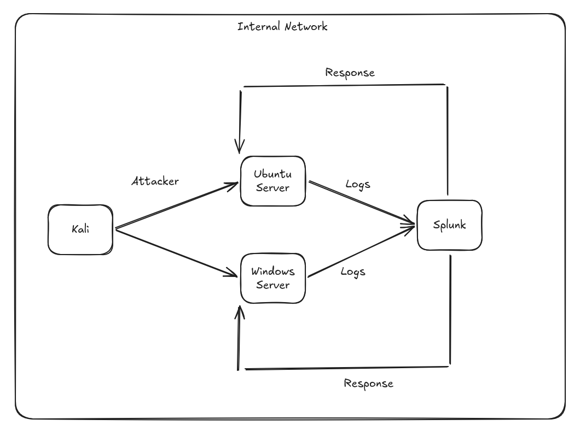

# Proposed Architecture

PurpleOps is being built as a local VirtualBox lab on my everyday openSUSE computer. This diagram shows the intended roles and flows; it does not represent a fully implemented environment.

## Overview

## Components

| Component | Purpose | Current state |
|---|---|---|
| Kali | Generate controlled test activity against lab targets. | A dedicated clone exists; its initial addressing and routes have been checked. |
| Linux target | Run SSH and produce authentication logs for the first case. | Not created yet. |
| Splunk | Store forwarded logs and support searches, detections, and investigation. | Not installed; introduced after studying local Linux telemetry. |
| Windows target | Support later Windows security exercises. | Deferred while the initial work focuses on Linux. |

## Network design

The exercise network is a VirtualBox **Internal Network** named `purpleops-lab`.

| Setting | Value | State |
|---|---|---|
| Lab IPv4 subnet | `192.168.50.0/24` | Selected |
| Kali IPv4 address | `192.168.50.10/24` | Configured and checked |
| Linux target IPv4 address | `192.168.50.20/24` | Proposed |
| Splunk and Windows addresses | Not assigned | Undecided |
| Default gateway during exercises | None | Kali has no observed IPv4 or IPv6 default route |

## How activity and evidence will move

1. Kali initiates controlled activity against a lab target.
2. The target generates local records, such as SSH authentication logs.
3. A log collector forwards the relevant records to Splunk.
4. I use the collected events to investigate the activity and develop detections.
5. I apply containment or remediation manually, then repeat the relevant test.

Splunk is intended to receive logs, not sniff all traffic on the virtual network. Local logs must be understood before forwarding and detection configuration are introduced.

Keeping Splunk separate from the target also helps preserve collected evidence: restoring the target does not roll back events already stored on the separate Splunk VM. Events that were never forwarded may be lost when the target is restored.
